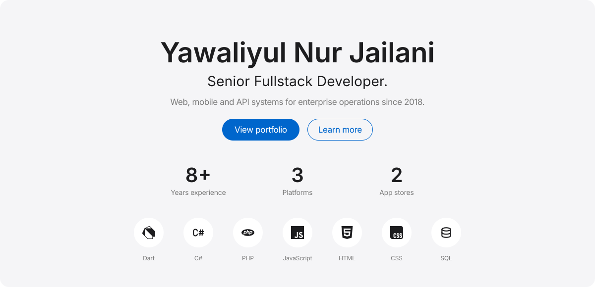
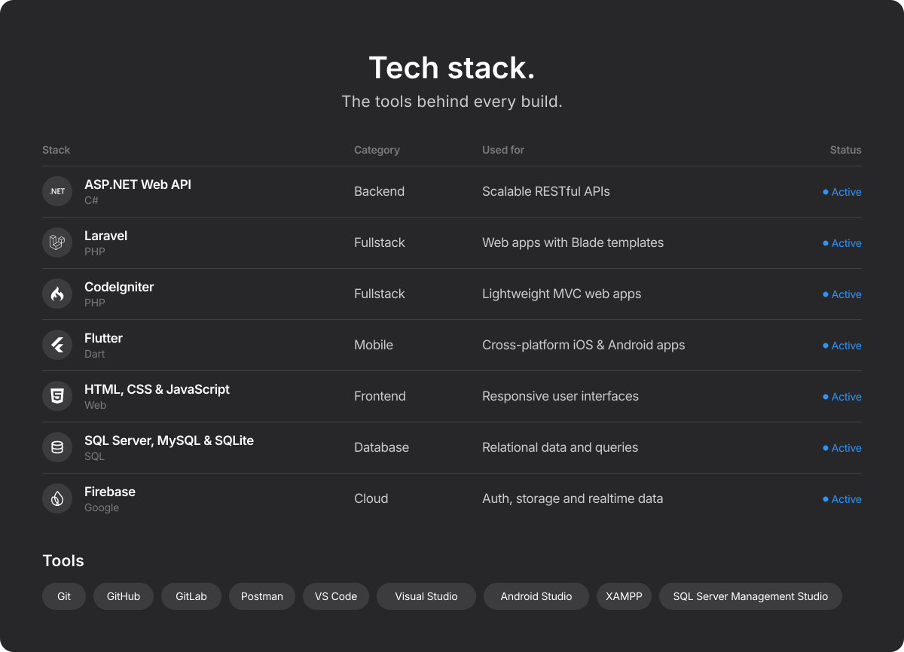
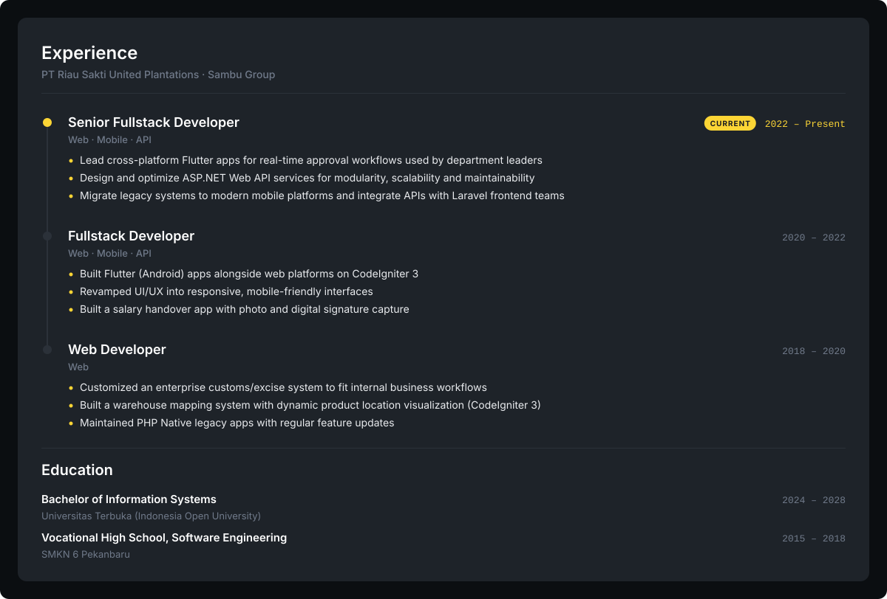
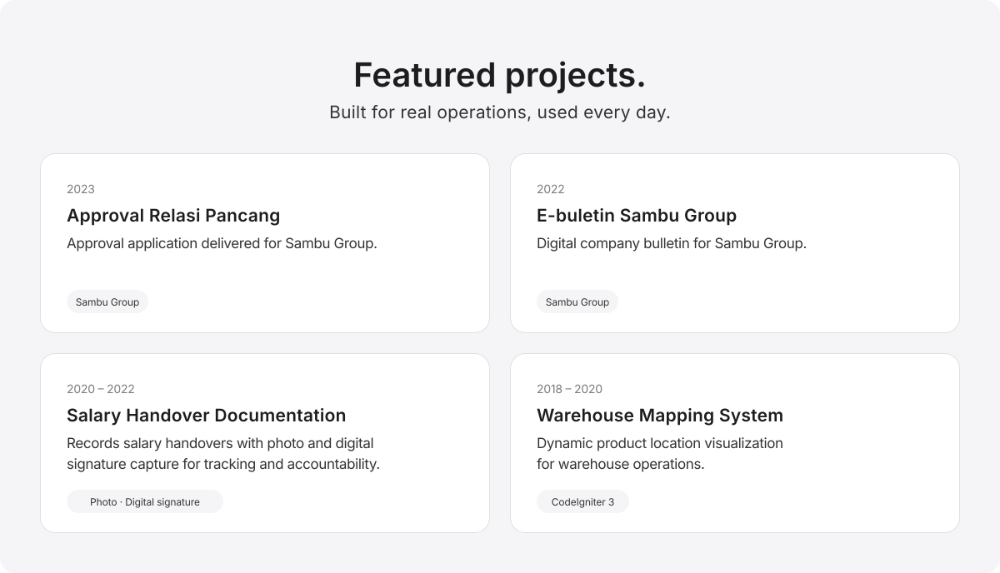
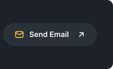
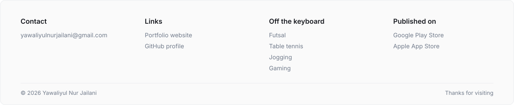

## About me

I'm a **Senior Fullstack Developer** at a large plantation and agribusiness company, where I've been building and maintaining web and mobile applications for enterprise operations since 2018. I build cross-platform apps with **Flutter** and scalable backend services with **ASP.NET Web API**, and I work closely with frontend teams on **Laravel** and **CodeIgniter**.

A big part of my work is migrating legacy systems into modern, user-friendly solutions that are faster and easier to maintain, from real-time approval workflows to warehouse management and internal business tools. I care about clean, efficient, and maintainable code.

Off the keyboard, you'll find me playing:

## GitHub stats

  
  

  

  <picture>
    <source media="(prefers-color-scheme: dark)" srcset="https://raw.githubusercontent.com/yawaliyulnurjailani/yawaliyulnurjailani/output/snake-apple-dark.svg" />
    
  </picture>

